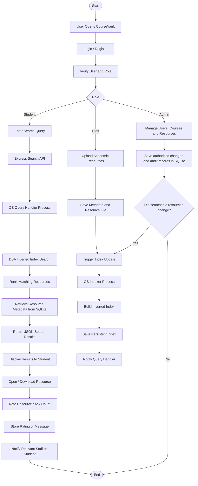

# CourseVault project workflow

This is the request path implemented by the local application. SQLite is the authoritative store for accounts and academic data; the persistent inverted index is derived data and can be rebuilt.

```text
                START
                  |
                  v
          User Opens CourseVault
                  |
                  v
            Login / Register
                  |
                  v
         Verify User and Role
                  |
          +-------+-------+
          |       |       |
          v       v       v
       Student  Staff    Admin
          |       |       |
          |       v       v
          |    Upload   Manage Users,
          |    Academic Courses and
          |    Resources Resources
          |       |
          |       v
          |    Save Metadata
          |    and Resource File
          |       |
          |       v
          |    Trigger Index Update
          |       |
          |       v
          |    OS Indexer Process
          |       |
          |       v
          |    Build Inverted Index
          |       |
          |       v
          |    Save Persistent Index
          |       |
          |       v
          |    Notify Query Handler
          |
          v
      Enter Search Query
          |
          v
      Express Search API
          |
          v
      OS Query Handler Process
          |
          v
      DSA Inverted Index Search
          |
          v
      Rank Matching Resources
          |
          v
      Retrieve Resource Metadata
      from SQLite
          |
          v
      Return JSON Search Results
          |
          v
      Display Results to Student
          |
          v
      Open / Download Resource
          |
          v
      Rate Resource / Ask Doubt
          |
          v
      Store Rating or Message
          |
          v
      Notify Relevant Staff or Student
          |
          v
                 END
```



## Runtime sequence

1. Run `npm run dev`. The launcher starts the Express API and Vite web client; the API starts separate indexer and query-handler child processes.
2. The first local run creates `data/coursevault.sqlite`, seeds demo records, and builds `data/search-index.json` from active resources.
3. Users **login or register** (student or staff). Admin accounts are created by an administrator. The API verifies the account, active status, and role on every protected operation.
4. **Staff** uploads save metadata and the file under `data/uploads/`, then trigger an index update over Node child-process IPC.
5. The **OS indexer** extracts searchable text, builds the inverted index, writes a persistent snapshot, and notifies the query handler to reload.
6. **Students** enter a search query. The Express search API sends it to the **OS query handler**, which runs **DSA inverted-index search**, ranks matches, then Express loads resource metadata from SQLite and returns JSON.
7. Students open or download a resource, then rate it or ask a doubt. Ratings and messages are stored in SQLite; CourseVault notifies the relevant staff or student.

## Recovery and demonstration

- Restart CourseVault: SQLite data and the last complete index remain under `data/`; startup reconciliation rebuilds the index from authoritative active resource records.
- Rebuild manually: sign in as Admin and use the Administration panel's index rebuild action.
- Demonstrate process recovery: in development, run the Administration crash-recovery check. It interrupts a temporary index write and checks that the previous complete snapshot remains intact.
- Demonstrate indexed lookup: sign in as Admin and inspect `/api/admin/search-index/term/<term>` for posting IDs and term frequency.
- Compare search strategies and response load with `npm run measure:index` and `npm run measure:load`. These scripts produce local measurements; run them on the target machine before reporting performance results.

See [ENGINE_DESIGN.md](ENGINE_DESIGN.md) for engine internals and [README.md](README.md) for setup, account, and data-storage details.
